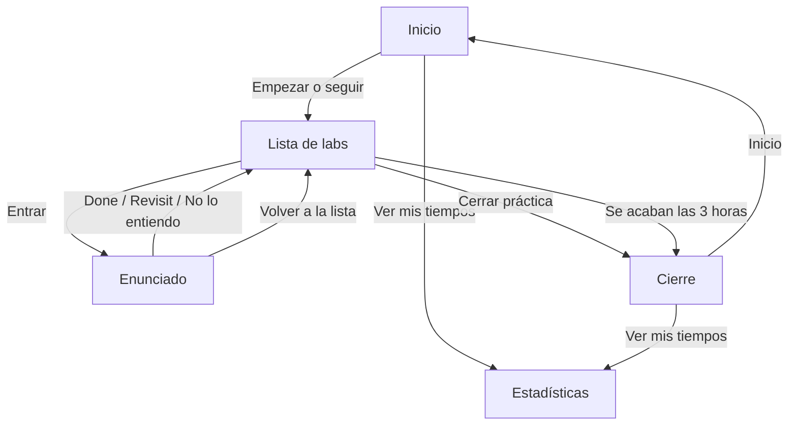
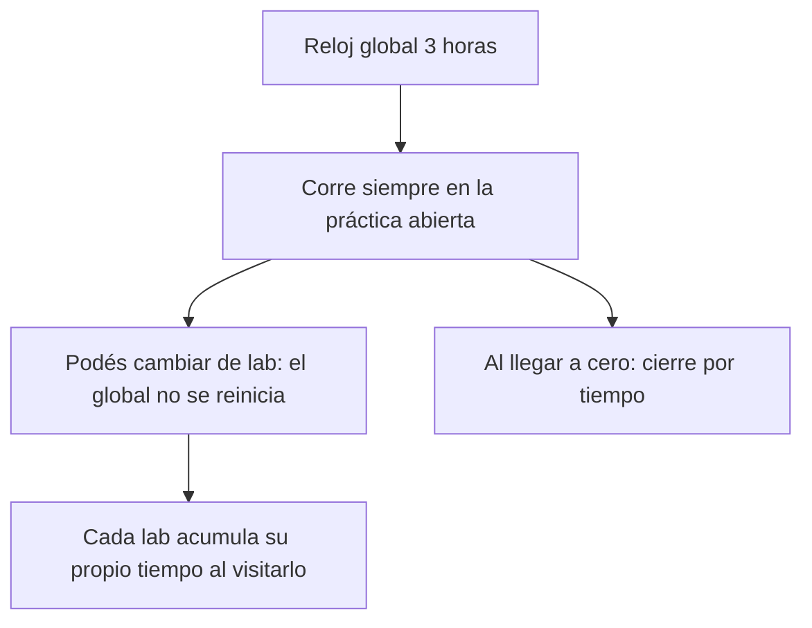

# Práctica personal de sysadmin Linux — arceprog

Práctica personal para un examen de sysadmin Linux en [exam-sysadmin-practice.arceprog.dev](https://exam-sysadmin-practice.arceprog.dev). Un lab por vez, reloj de 3 horas y estadísticas en `localStorage` de este navegador.

```bash
npm install
npm run dev
```

El dev server usa el puerto **4322**.

Los enunciados son práctica propia sobre dos VMs (`client` `172.16.1.12`, `server` `172.16.1.13`) y los nombres Felipe, Erik, Diego y Joaquin. La ayuda (comandos y videos) no aparece hasta apretar **Pedí ayuda**. Enlaces de apoyo: [lista de YouTube](https://www.youtube.com/playlist?list=PLzwsIhHG_OdZiC6ugglW4TzjIM8wrJDrt) y [repo de labs](https://github.com/nbaud/rhcsa_lab).

## Flujos



### Empezar

En el inicio elegís la edición (10 = Flatpak en la lista principal; 9 = Podman). Hoy el modo activo es **sin pausas** (3 horas de corrido). El modo con pausas está en el código pero **apagado** (`PAUSABLE_ENABLED = false`).

| Acción | Qué cambia ahí |
|---|---|
| Empezar | Abre la lista de labs. Reloj global de 3 horas, sin botón de pausa. |
| Seguí donde quedaste | Si hay una práctica `in_progress`, retoma esa lista. |
| Empezar otra edición | Si cambiás 10 ↔ 9 y empezás de nuevo, la práctica abierta pasa al historial como abandonada. |
| Ver mis tiempos | Va a Estadísticas. |

### Hacer un lab

En la lista ves client / server / extras. Al entrar: enunciado, objetivos y relojes (global + este lab). La ayuda no está hasta que la pedís.

| Acción | Qué cambia ahí |
|---|---|
| Entrar | Abre el enunciado. Si es la primera vez, arranca el reloj de ese lab. |
| Pedí ayuda | Muestra pasos, comandos y videos. Marca el lab con ayuda. |
| Done | Vuelve a la lista; pedís dificultad en esa fila. |
| Revisit (volver después) | Vuelve a la lista marcado para retomar. |
| No lo entiendo | Vuelve a la lista como pasado; no cuenta como hecho. |
| Rehacer | Pone el reloj de ese lab en cero, suma un intento; seguís en el enunciado. |
| Volver a la lista | Cierra el enunciado. El tiempo de esa visita se guarda en el lab. |

F5 o cambiar de pestaña: el tiempo del lab **sigue** (se acumula en `localStorage` / sesión). No hay Deshacer.

Al marcar, en la fila del lab ves estado y dificultad. El **gráfico de temas no** aparece en la lista ni en el enunciado.

### Reloj



El reloj global no se pausa (modo pausable desactivado). El de cada lab suma solo mientras estás en ese enunciado (y se conserva al volver).

### Cerrar

Desde la lista: **Cerrar práctica**, o se agotan las 3 horas. Ves tiempo total, recuento (done / revisit / rehacer / no entiendo / ayuda) y la tabla de labs. **Ver mis tiempos** → Estadísticas. **Inicio** → home. No hay gráfico de temas en este cierre.

### Estadísticas

Orden actual de la pantalla:

1. Gráfico / cobertura por temas  
2. Mejora vs la práctica anterior  
3. Totales  
4. Tabla por lab  
5. Historial  
6. Export / import  

Como el modo con pausas está apagado, no hay pestañas fixed/pausable: todo es el modo sin pausas.

El gráfico no dice qué lab movió cada tema: hay que abrir el tema y mirar la lista de labs.
